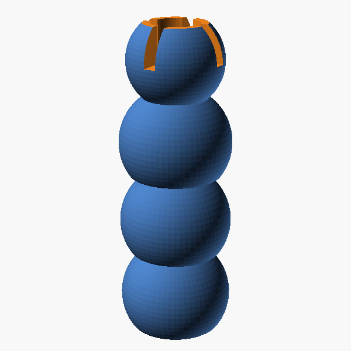

# segmented-hose-scad

One segment of a ball-and-socket hose, the kind used to aim coolant or air, modelled in OpenSCAD.
Each segment has a socket at the bottom and a ball on top that snaps into the next segment's
socket; two slits let the ball flex, and a bore runs through both. Print as many as you need and
push them together.



## Use it

Open `segmented_hose.scad` in [OpenSCAD](https://openscad.org) and set the parameters in the
Customizer, or use the module from another design:

```scad
use <segmented-hose-scad/segmented_hose.scad>
$fn = 128;

segmented_hose_segment(coupling_diameter = 12, bore = 6, clearance = 0.1);
```

- `coupling_diameter` is the ball's diameter and the socket's. `thickness` is the wall round the
  socket, `bore` the hole through the segment, `slit_dim` the width of the ball's two slits.
- `clearance` is added to the socket's diameter: 0 (the default) is a tight fit that relies on the
  print; more is looser.
- The factors set the proportions as fractions of `coupling_diameter`: the distance between the
  socket's centre and the ball's (`center_distance_factor`, which is also the chain's pitch), and
  how much of the ball's top and the socket's bottom is cut off.
- A segment stands on z = 0 with its axis on z. `segmented_hose_pitch()`,
  `segmented_hose_height()` and `segmented_hose_mouth()` give the chain's pitch, a segment's height
  and the width of the socket's mouth.
- `segments` in the Customizer previews a straight chain.
- From another file, set `$fn` yourself: a `use`d file's own `$fn` doesn't reach its modules.

A segment is refused, with a message, if its bore leaves no wall in the ball, or if the socket's
mouth would be as wide as the ball, which would then fall out.

Print segments upright, socket down.

## Checks

`just test` takes about 2 s on OpenSCAD 2026.10.15. For three sizes, it renders a segment with
warnings treated as errors and checks that it's one solid of its outside size, standing on z = 0,
and that the socket's mouth is narrower than the ball. It then sets a second segment one pitch
above the first and checks that, at a clearance of 0.2 mm, its ball sits in the socket without
overlapping it, and that at -0.2 mm it does overlap. It also checks the two refusals.

`just images` renders the picture above.

## Plans

Threaded end pieces, to fix a line to something, are tracked in #1.

## Licence

MIT; see [LICENSE](LICENSE).

Loc-Line is a trademark of Lockwood Products. This project isn't affiliated with Lockwood
Products, and its parts aren't claimed to fit theirs.
